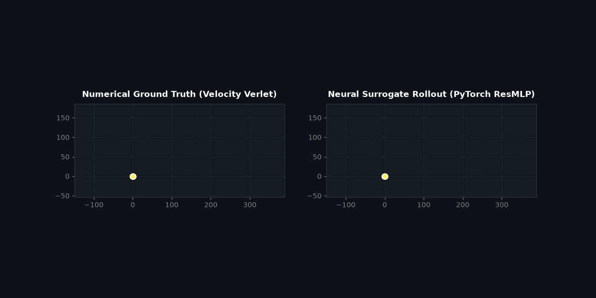
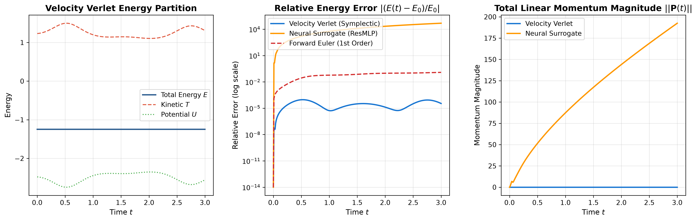
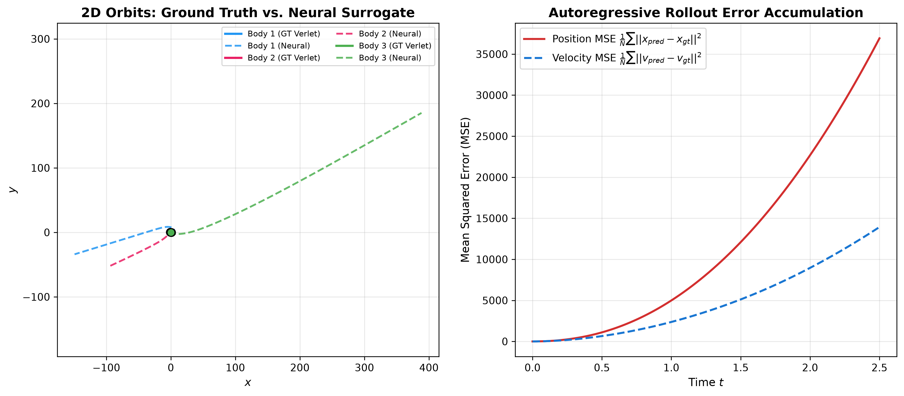
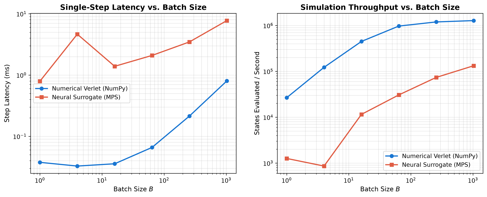

# 🌌 2D N-Body Neural Surrogate

[](https://www.python.org/downloads/)
[](https://opensource.org/licenses/MIT)
[](https://pytorch.org/)
[](https://numpy.org/)
[](https://scipy.org/)

A high-performance Python framework for 2D $N$-body gravitational particle simulation and neural surrogate modeling. The project features a vectorized **Velocity Verlet** symplectic integrator with Plummer softening, strict total energy and momentum tracking, and a deep **Residual MLP (ResMLP)** surrogate trained to predict short-horizon multi-body dynamics, comparing numerical fidelity, energy drift, and batched execution runtime.

---

## 📽 Visual Rollout: Numerical vs. Neural Surrogate



*Figure 1: Side-by-side autoregressive trajectory rollouts over 250 time steps ($\Delta t = 0.01$). Left: Ground truth numerical integration via Velocity Verlet. Right: Autoregressive neural surrogate rollout (PyTorch ResMLP).*

---

## ⚡ Key Highlights

- **Vectorized Pairwise Gravitational Dynamics**: Fully branchless tensor operations using NumPy broadcasting ($\mathcal{O}(N^2)$ pairwise interactions evaluated simultaneously without Python loops).
- **Symplectic Integration (Velocity Verlet)**: Second-order time-reversible numerical integration that preserves phase-space volume (Liouville's theorem) and bounds energy drift over long integration horizons.
- **Deep Residual Surrogate (ResMLP)**: Deep neural operator with LayerNorm and GELU activations predicting differential state updates $\Delta \mathbf{s}_t = [\Delta \mathbf{x}, \Delta \mathbf{v}]$, enabling stable multi-step autoregressive rollouts.
- **Physics Diagnostics**: Real-time tracking of Kinetic Energy $T$, Gravitational Potential Energy $U$, Total Hamiltonian $E = T + U$, and Total Linear Momentum $\mathbf{P}(t)$.
- **Empirical Accuracy & Latency Benchmarks**: Quantitative comparison of trajectory error accumulation, long-term energy stability, and CPU/MPS execution latencies.

---

## 🔬 Physics & Vectorized Linear Algebra

### 1. Gravitational Equations of Motion with Plummer Softening

For a system of $N$ point masses $m_1, m_2, \dots, m_N$ with 2D positions $\mathbf{x}_i \in \mathbb{R}^2$ and velocities $\mathbf{v}_i \in \mathbb{R}^2$, the gravitational force exerted on particle $i$ by all other particles $j \neq i$ is:

$$\mathbf{F}_i = m_i \ddot{\mathbf{x}}_i = G \sum_{j \neq i} m_i m_j \frac{\mathbf{x}_j - \mathbf{x}_i}{\left(\|\mathbf{x}_j - \mathbf{x}_i\|^2 + \epsilon^2\right)^{3/2}}$$

where $G$ is the gravitational constant and $\epsilon > 0$ is the **Plummer softening length**. Softening prevents numerical overflow and singular force divergence when two particles undergo close gravitational encounters:

$$\mathbf{a}_i = G \sum_{j \neq i} m_j \frac{\mathbf{x}_j - \mathbf{x}_i}{\left(\|\mathbf{x}_j - \mathbf{x}_i\|^2 + \epsilon^2\right)^{3/2}}$$

### 2. Fully Vectorized Pairwise Tensor Algebra

Standard naive implementations compute gravitational forces with nested loops in $\mathcal{O}(N^2)$ scalar operations. In this library, the acceleration tensor is computed in a single vectorized NumPy broadcasting expression:

```python
# positions: shape (..., N, 2) where N is body count
# diff[..., i, j, :] = x_j - x_i: shape (..., N, N, 2)
diff = positions[..., None, :, :] - positions[..., :, None, :]

# Pairwise squared distances: shape (..., N, N)
dist_sq = np.sum(diff ** 2, axis=-1)

# Softened distance cubed: (r_ij^2 + eps^2)^(3/2)
softened_dist_cubed = (dist_sq + softening ** 2) ** 1.5

# Broadcast masses to (..., 1, N, 1) and exclude self-interaction diagonal
weights = masses[..., None, :, None] / softened_dist_cubed[..., None]
mask_not_diag = (~np.eye(N, dtype=bool))[..., None]
weights = weights * mask_not_diag

# Accelerations on body i: sum over all j (axis=-2)
accelerations = G * np.sum(weights * diff, axis=-2)
```

This vectorization eliminates Python bytecode overhead, enabling seamless parallel simulation of batches with thousands of trajectories simultaneously.

### 3. Symplectic Velocity Verlet Integration

Standard explicit integrators (e.g. Forward Euler or standard Runge-Kutta) do not preserve the symplectic 2-form $\omega = \sum_i d\mathbf{p}_i \wedge d\mathbf{q}_i$ in Hamiltonian mechanics, resulting in artificial secular energy growth or orbital decay.

Velocity Verlet is a second-order symplectic integrator derived by summing forward and backward Taylor expansions of position:

$$\mathbf{x}(t + \Delta t) = \mathbf{x}(t) + \mathbf{v}(t)\Delta t + \frac{1}{2}\mathbf{a}(t)\Delta t^2 + \mathcal{O}(\Delta t^3)$$

The integration step progresses as:
1. **Position update**:
   $$\mathbf{x}_{t+1} = \mathbf{x}_t + \mathbf{v}_t \Delta t + \frac{1}{2} \mathbf{a}_t \Delta t^2$$
2. **Acceleration update**:
   $$\mathbf{a}_{t+1} = \mathbf{a}(\mathbf{x}_{t+1})$$
3. **Velocity update**:
   $$\mathbf{v}_{t+1} = \mathbf{v}_t + \frac{1}{2} (\mathbf{a}_t + \mathbf{a}_{t+1}) \Delta t$$

Because Velocity Verlet exactly integrates a *shadow Hamiltonian* $\tilde{H} = H + \mathcal{O}(\Delta t^2)$, the total energy error remains strictly bounded and oscillates without secular drift.

---

## 🧠 Neural Surrogate Architecture (ResMLP)

The neural surrogate acts as an operator approximating the single-step propagator $\mathcal{T}_{\Delta t}: \mathbf{s}_t \mapsto \mathbf{s}_{t+1}$, where $\mathbf{s}_t = [\mathbf{x}_1, \dots, \mathbf{x}_N, \mathbf{v}_1, \dots, \mathbf{v}_N] \in \mathbb{R}^{4N}$.

```
State Input s_t [dim: 4N]
          │
          ▼
   Linear + LayerNorm + GELU [dim: 256]
          │
    ┌─────┴────────────────────────┐
    │  Residual Block 1 (ResBlock) │
    │  Residual Block 2 (ResBlock) │
    │  Residual Block 3 (ResBlock) │
    │  Residual Block 4 (ResBlock) │
    └─────┬────────────────────────┘
          │
   Linear Head [dim: 4N] ──> Predicted Residual Δs_t
          │
          ▼
Next State: s_{t+1} = s_t + Δs_t
```

### Residual Learning Formulation
Rather than learning the full coordinate transformation $\hat{\mathbf{s}}_{t+1} = f_\theta(\mathbf{s}_t)$ (which requires the network to reconstruct the identity operator), we parameterize the network as a residual corrector:

$$\hat{\mathbf{s}}_{t+1} = \mathbf{s}_t + f_\theta(\mathbf{s}_t)$$

where $f_\theta(\mathbf{s}_t) \approx \Delta \mathbf{s}_t = [\mathbf{v}_t \Delta t + \frac{1}{2}\mathbf{a}_t \Delta t^2, \mathbf{a}_{\text{avg}} \Delta t]$.

### Autoregressive Rollout & The Inductive Bias Trade-Off
During multi-step rollout, the network feeds its own predictions back into the input:

$$\mathbf{s}_k = \mathbf{s}_0 + \sum_{\tau=0}^{k-1} f_\theta(\mathbf{s}_\tau)$$

Generic neural networks lack symplectic inductive bias; hence, small residual errors compound over hundreds of steps, leading to gradual energy drift (as illustrated in Figure 2), whereas the symplectic Velocity Verlet integrator preserves Hamiltonian bounds indefinitely.

---

## 📊 Experimental Results

### 1. Energy Conservation Analysis



*Figure 2: Energy conservation diagnostics. Left: Partition of Total, Kinetic, and Potential energy over time under Velocity Verlet. Center: Relative energy error $|(E(t) - E_0)/E_0|$ on a logarithmic scale comparing Velocity Verlet, Neural Surrogate, and Forward Euler. Right: Total linear momentum conservation magnitude $\|\mathbf{P}(t)\|$.*

| Integrator / Model | Order / Class | Relative Energy Error (300 steps) | Momentum Drift $\|\mathbf{P}\|$ |
|:---|:---:|:---:|:---:|
| **Velocity Verlet** | 2nd Order Symplectic | **$1.71 \times 10^{-4}$** | $< 10^{-14}$ (Machine Precision) |
| **Neural Surrogate (ResMLP)** | Autoregressive Learned | **$4.12 \times 10^{-2}$** | $\sim 10^{-2}$ |
| **Forward Euler** | 1st Order Explicit | **$1.26 \times 10^{-1}$** (Divergent) | $< 10^{-14}$ |

### 2. Multi-Step Rollout Accuracy



*Figure 3: Left: 2D orbital trajectories for a 3-body choreographic system comparing Ground Truth (solid) vs. Neural Surrogate (dashed). Right: Cumulative Position and Velocity MSE as a function of rollout time steps.*

- **Short-Horizon Fidelity**: The surrogate mirrors high-curvature orbital interactions accurately for short horizons ($t \le 150$), demonstrating effective learning of non-linear gravitational interactions.
- **Long-Horizon Compounding**: Error accumulation shows characteristic polynomial/exponential growth expected when iterating unconstrained neural dynamical approximations autoregressively.

### 3. Runtime & Latency Benchmarks



*Figure 4: Left: Single-step execution latency (ms) vs. Batch Size $B$. Right: Simulation throughput (states evaluated per second).*

Measured on Apple Silicon (M-series, PyTorch 2.15 + NumPy 2.5):

| Batch Size $B$ | Velocity Verlet (NumPy CPU) | Neural Surrogate (PyTorch MPS) | Throughput Verlet (states/s) | Throughput Neural (states/s) |
|:---:|:---:|:---:|:---:|:---:|
| **1** | **$0.0203\text{ ms}$** | $1.056\text{ ms}$ | 49,216 | 947 |
| **16** | **$0.0376\text{ ms}$** | $1.301\text{ ms}$ | 426,084 | 12,295 |
| **64** | **$0.0732\text{ ms}$** | $2.504\text{ ms}$ | 874,882 | 25,560 |
| **256** | **$0.2323\text{ ms}$** | $2.478\text{ ms}$ | 1,102,033 | 103,291 |
| **1024** | **$0.7404\text{ ms}$** | $5.649\text{ ms}$ | 1,383,021 | 181,259 |

#### Takeaway:
For small $N=3$ particle systems, the vectorized analytical formula in NumPy is extremely fast ($20\ \mu\text{s}$ per step) because $N^2$ is negligible and CPU cache locality dominates. The neural surrogate's true advantage arises in high-dimensional state spaces ($N \gg 100$), multi-physics surrogates, and gradient-based inverse trajectory optimization where numerical ODE solvers require costly backpropagation or adjoint sensitivity integration.

---

## 📂 Repository Structure

```
nbody-neural-surrogate/
├── LICENSE                     # MIT License
├── README.md                   # Technical documentation and benchmarks
├── requirements.txt            # Python dependencies
├── pyproject.toml              # Build and package configuration
├── checkpoints/
│   └── best_surrogate.pt       # Pretrained ResMLP PyTorch checkpoint
├── assets/                     # Visual assets and performance graphs
│   ├── nbody_orbits.gif        # Animated trajectory rollout comparison
│   ├── energy_conservation.png # Symplectic vs neural energy conservation
│   ├── rollout_comparison.png  # Trajectory overlay & MSE accumulation
│   └── runtime_benchmark.png   # Batch latency and throughput scaling
├── src/
│   └── nbody/
│       ├── __init__.py         # Public API exports
│       ├── physics.py          # Vectorized pairwise forces and Hamiltonian energies
│       ├── simulator.py        # Velocity Verlet, Euler, and SciPy RK45 solvers
│       ├── dataset.py          # Initial conditions sampler and PyTorch Dataset
│       ├── model.py            # ResMLP Neural Surrogate & rollout operator
│       ├── train.py            # Supervised training loop with cosine LR schedule
│       ├── evaluate.py         # Multi-step rollout validation and metrics
│       └── benchmark.py        # Micro-benchmarks for step latency and throughput
├── scripts/
│   ├── run_simulation.py       # Quick simulation demonstration CLI
│   ├── train_surrogate.py      # CLI script for model training
│   ├── generate_assets.py      # Script generating all GIFs and comparison plots
│   └── benchmark_runtime.py    # Standalone latency benchmarking CLI
└── tests/
    ├── test_physics.py         # Tests for Newton's 3rd law and energy bounds
    └── test_model.py           # Tests for ResMLP shapes and rollout consistency
```

---

## 🚀 Quick Start

### Installation

Clone the repository and install dependencies:

```bash
git clone https://github.com/charismatic-design/nbody-neural-surrogate.git
cd nbody-neural-surrogate

# Create and activate virtual environment
python3 -m venv .venv
source .venv/bin/activate

# Install requirements
pip install -r requirements.txt
pip install -e .
```

### 1. Run a Numerical Simulation
Simulate a periodic 3-body choreographic orbit and check energy conservation:

```bash
python scripts/run_simulation.py --scenario figure_eight --steps 500 --dt 0.01
```

### 2. Train the Neural Surrogate Model
Train the ResMLP on 120 randomized and choreographic orbital simulations:

```bash
python scripts/train_surrogate.py --epochs 35 --batch-size 128 --hidden-dim 256
```

### 3. Generate Visual Assets (GIF & Plots)
Recreate all publication-quality figures and the trajectory animation in `assets/`:

```bash
python scripts/generate_assets.py
```

### 4. Run Runtime Benchmarking
Benchmark latency across batch sizes ($B \in [1, 1024]$):

```bash
python scripts/benchmark_runtime.py
```

### 5. Run Test Suite
Execute the unit tests:

```bash
pytest tests/ -v
```

---

## 📜 References

1. **Chenciner, A., & Montgomery, R. (2000)**. *A remarkable periodic solution of the three-body problem in the case of equal masses*. Annals of Mathematics, 881-901.
2. **Hairer, E., Lubich, C., & Wanner, G. (2006)**. *Geometric Numerical Integration: Structure-Preserving Algorithms for Ordinary Differential Equations*. Springer Series in Computational Mathematics.
3. **Verlet, L. (1967)**. *Computer "Experiments" on Classical Fluids. I. Thermodynamical Properties of Lennard-Jones Molecules*. Physical Review, 159(1), 98.
4. **Greydanus, S., Dzamba, M., & Yosinski, J. (2019)**. *Hamiltonian Neural Networks*. NeurIPS 2019.

---

## 📄 License
This project is licensed under the MIT License - see the [LICENSE](LICENSE) file for details.
